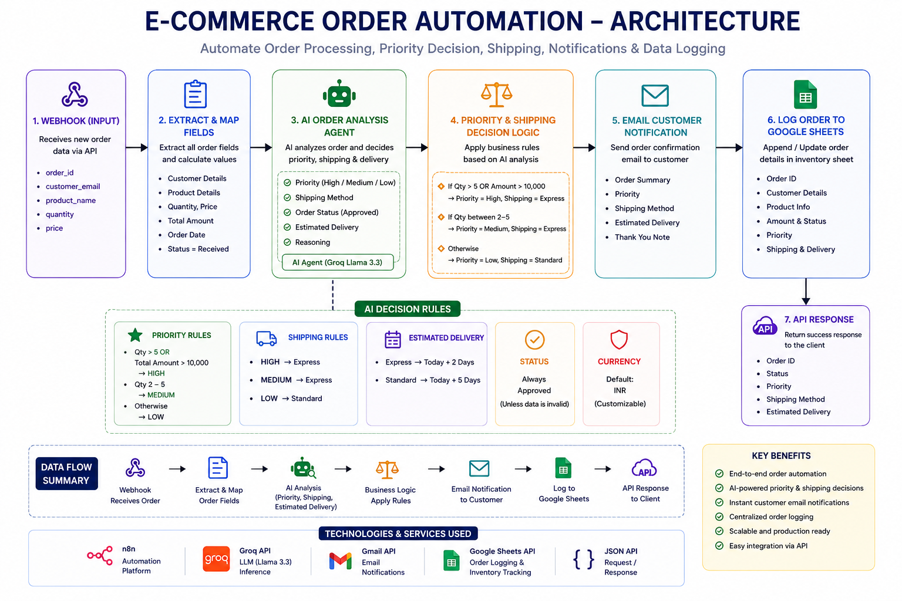
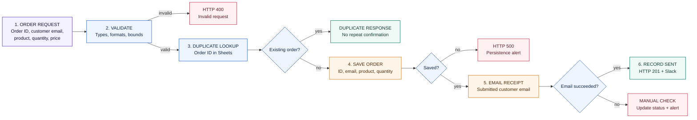

# E-commerce Order Intake & Confirmation — Architecture

**Accept an order request, validate it, detect common duplicates, save a minimal record, and email a receipt-of-request confirmation.**

## 1. Workflow at a glance

## 2. Input and output boundary

| Input | Workflow output |
|---|---|
| Order ID, customer email, product name, quantity, caller-supplied price | Minimal Sheet record, order-total receipt email, status updates, Slack operational alerts |

The email explicitly confirms receipt of a request only. Payment, inventory reservation, shipment, and fulfillment are not connected. The visible new-order mapping does not save the price/total, although the email computes a total from the submitted price.

## 3. Services used

`n8n` · `Google Sheets` order log · `Gmail` customer receipt · `Slack` operations notices.

## 4. Security and integrity notes

- Source webhook is unauthenticated. Use a signed/authenticated commerce-platform caller; do not expose as a public email relay.
- Resolve price from a trusted server-side catalogue; caller-supplied price is not authoritative.
- Verify customer/order identity before sending to the submitted address. Validate order state in the source commerce system.
- Sheet lookup-then-upsert can race. Use an atomic idempotency mechanism for strict duplicate prevention.
- Protect customer email/order data and use synthetic records in portfolio demos.

> **Portfolio output:** 21 nodes and 14 connection groups. This is an intake/confirmation prototype, not a payment or fulfillment system.
